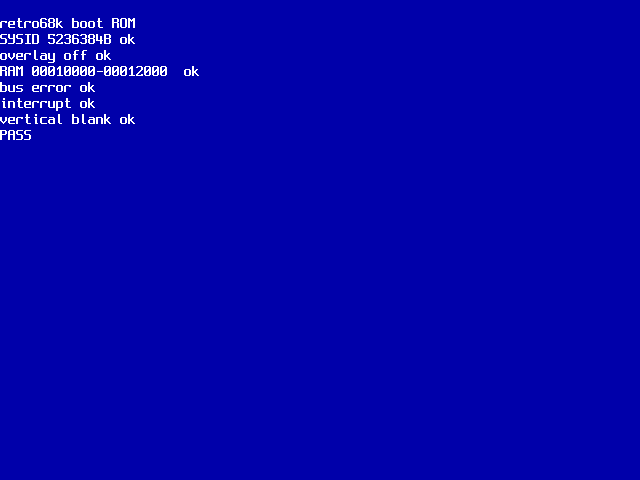

# retro68k

A homebrew Motorola 68000 computer with Amiga-style shared memory and an FPGA handling video and audio. It runs on a **ZX Spectrum Next KS3** board: the 68000 is a core inside the board's Artix-7 FPGA, and main memory is the board's fast SRAM.

## Goals

- **CPU:** 68000 at 20 MHz, the fx68k core inside the FPGA
- **Memory:** 4 MB of Amiga-style Chip RAM in fast SRAM, shared with DMA in fixed memory cycles; the CPU has its own cycle in every slot, so it never waits for the display or sound
- **ROM:** boot ROM with a monitor, held in FPGA block RAM
- **Video:** HDMI and VGA, programmable modes from 640×480 to 1280×720, 4 layers, 64 sprites, a copper
- **Audio:** 16 sample channels with sinc resampling, plus a stereo stream
- **DMA engine:** copies, fills and blits, and feeds the SD card and USB serial
- **I/O:** USB serial (FT232H module), SD card, PS/2 and Spectrum keyboards, real-time clock, timers, interrupts

## Block diagram

```
                       ZX Spectrum Next KS3
 +---------------------------------------------------------------+
 |  Artix-7 XC7A35T FPGA                                         |
 |  +--------+   +-----------+   +-----------------------------+ |      +-----------+
 |  | fx68k  |<->| bus, glue |<->| SRAM controller (slots)     |<------>| 4 MB SRAM |
 |  | 68000  |   | boot ROM  |   +-----------------------------+ |      +-----------+
 |  +--------+   +-----------+     ^      ^      ^      ^        |
 |                    |           video  audio  copper DMA engine|---> HDMI, VGA
 |                    v                                          |---> audio jack
 |         timers, interrupts, SD, keyboard, serial, I2C         |
 +---------------------------------------------------------------+
            |            |              |              |
         SD card    PS/2 + Spectrum   FT232H USB    RTC (I2C)
                      keyboards       (accelerator port)
```

## Status

The computer runs in simulation (`make -C sim`): fx68k boots the ROM, checks memory, interrupts and video, and prints to the USB serial link and the screen:



## Design plan

Decisions, memory map, phases and open questions are in [`docs/design-plan.md`](docs/design-plan.md). Each block has a spec in [`docs/spec/`](docs/spec/).

## Repository layout

| Folder              | Contents                                       |
|---------------------|------------------------------------------------|
| `docs/`             | Design plan and specs                          |
| `fpga/`             | Register map source (`regmap.def`); Verilog in `fpga/rtl/` |
| `firmware/boot/`    | 68000 assembly boot ROM / monitor              |
| `firmware/include/` | Generated hardware definitions for assembler (`hw.inc`) and C (`hw.h`) |
| `tools/`            | Register map generator (`regmap.py`), `bin2hex.py`; later build scripts and the USB loader |
| `sim/`              | System simulation (Icarus Verilog): `make -C sim` |
| `hardware/`         | Wiring for the FT232H module                   |

## Toolchain

- **68000 code:** `vasm` (Motorola syntax) or `m68k-elf-gcc`
- **FPGA:** Vivado (free edition), scripted with Tcl; simulation with Verilator and Icarus Verilog
- **Loading:** JTAG during development; installed as a Next core when finished

## Roadmap

1. [ ] FPGA bring-up: HDMI/VGA test pattern, USB serial echo
2. [x] Whole computer in simulation: boot ROM checks on the serial link and the screen
3. [ ] Computer on the board: "hello" on a monitor, RAM test, boot monitor
4. [ ] Video: bitmap layers, palette, scrolling, sprites, copper
5. [ ] Audio: sample channels and stream
6. [ ] DMA engine
7. [ ] Home computer: SD card, keyboards, real-time clock, BASIC
8. [ ] Installed as a Next core

## License

MIT — see `LICENSE`. The fx68k core, when added, is GPL-3.0, so FPGA builds that include it are covered by the GPL.
